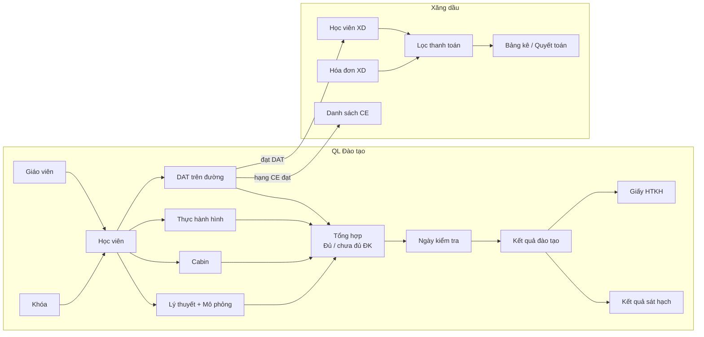
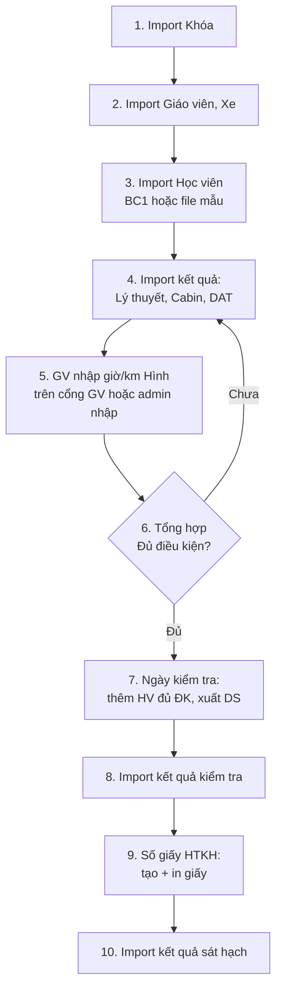
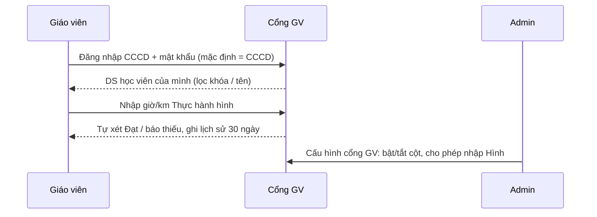
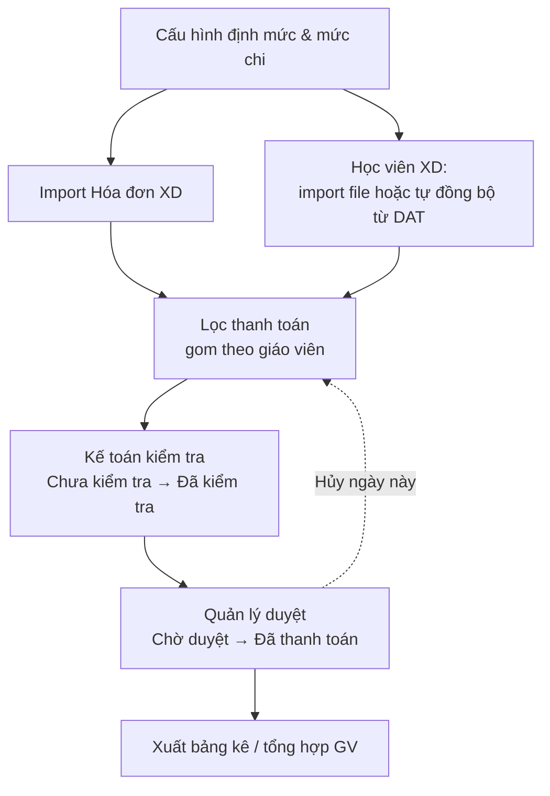
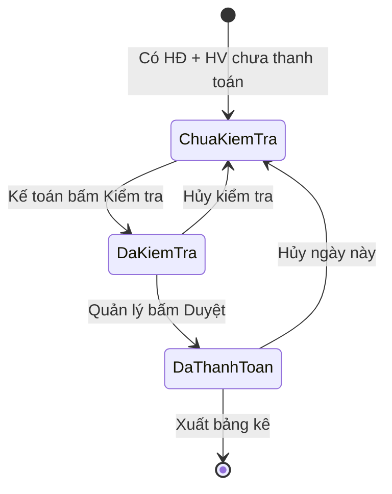
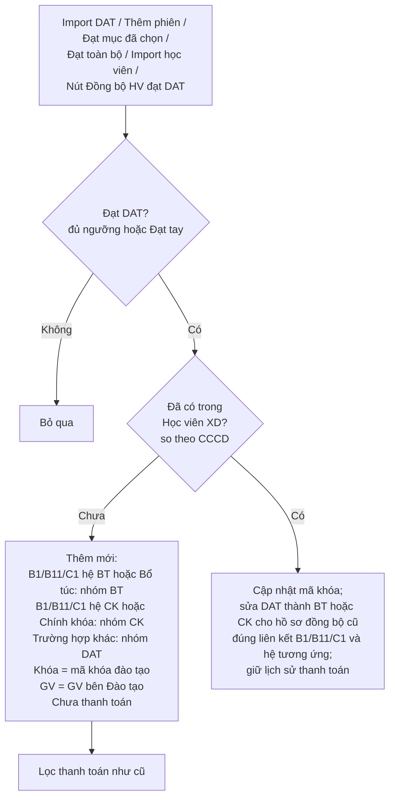

# HƯỚNG DẪN SỬ DỤNG — ĐÀO TẠO & XĂNG DẦU

Tài liệu dành cho người dùng trang quản trị (admin), kế toán và giáo viên.

## Mục lục

- [1. Tổng quan](#1-tổng-quan)
- [2. Phân quyền](#2-phân-quyền)
- [3. QL Đào tạo](#3-ql-đào-tạo)
  - [3.1 Quy trình chuẩn](#31-quy-trình-chuẩn)
  - [3.2 Khóa đào tạo](#32-khóa-đào-tạo)
  - [3.3 Học viên](#33-học-viên)
  - [3.4 Giáo viên & Xe tập lái](#34-giáo-viên--xe-tập-lái)
  - [3.5 Lý thuyết · Cabin · Thực hành hình · DAT](#35-lý-thuyết--cabin--thực-hành-hình--dat)
  - [3.6 Tổng hợp](#36-tổng-hợp)
  - [3.7 Ngày kiểm tra & Kết quả đào tạo](#37-ngày-kiểm-tra--kết-quả-đào-tạo)
  - [3.8 Số giấy HTKH (giấy xác nhận hoàn thành)](#38-số-giấy-htkh-giấy-xác-nhận-hoàn-thành)
  - [3.9 Kết quả sát hạch](#39-kết-quả-sát-hạch)
  - [3.10 Cổng giáo viên](#310-cổng-giáo-viên)
  - [3.11 Tổng quan · Nhật ký · Sao lưu](#311-tổng-quan--nhật-ký--sao-lưu)
- [4. Xăng dầu (XD)](#4-xăng-dầu-xd)
  - [4.1 Quy trình chuẩn](#41-quy-trình-chuẩn)
  - [4.2 Cấu hình định mức](#42-cấu-hình-định-mức)
  - [4.3 Hóa đơn XD](#43-hóa-đơn-xd)
  - [4.4 Học viên XD](#44-học-viên-xd)
  - [4.5 Lọc thanh toán (kiểm tra → duyệt → bảng kê)](#45-lọc-thanh-toán-kiểm-tra--duyệt--bảng-kê)
  - [4.6 Danh sách CE](#46-danh-sách-ce)
- [5. Đồng bộ Đào tạo (DAT) → Xăng dầu](#5-đồng-bộ-đào-tạo-dat--xăng-dầu)
- [6. Thao tác chung](#6-thao-tác-chung)
- [7. Câu hỏi thường gặp](#7-câu-hỏi-thường-gặp)

---

## 1. Tổng quan

- **Đào tạo**: theo dõi học viên từ lúc vào khóa → đủ điều kiện → kiểm tra → cấp giấy → sát hạch.
- **Xăng dầu**: trích chi phí xăng dầu cho giáo viên dựa trên hóa đơn và số học viên đã dạy.
- Học viên **đạt DAT** tự động chuyển sang Xăng dầu (xem [mục 5](#5-đồng-bộ-đào-tạo-dat--xăng-dầu)).

---

## 2. Phân quyền

Vào **Người dùng → Nhóm quyền**, tick quyền cho nhóm, rồi gán nhóm cho tài khoản. Menu và nút bấm chỉ hiện đúng phần được tick.

**Đào tạo** — mỗi mục (Khóa, Học viên, Xe, Giáo viên, Lý thuyết, Cabin, Hình, DAT, Tổng hợp, Ngày kiểm tra, Kết quả, HTKH, Sát hạch) có 5 quyền:

| Quyền | Cho phép |
|---|---|
| Tra cứu | Xem danh sách, lọc |
| Sửa | Thêm / sửa, bấm "Đạt" thủ công, tạo giấy |
| Xóa | Xóa dòng / xóa mục đã chọn |
| Import | Nhập file Excel |
| Xuất excel | Tải file Excel |

Quyền nhanh: **Quản trị đào tạo** (`daotao_man`) = toàn quyền + Tổng quan, Nhật ký, Sao lưu, Cấu hình cổng GV. **Tra cứu mọi mục** = chỉ xem + xuất.

**Xăng dầu**:

| Quyền | Cho phép |
|---|---|
| Xem và quản lý | Toàn quyền |
| Kế toán | Import, xem, kiểm tra, xuất bảng kê theo GV (không duyệt, không xóa, không cấu hình) |
| Xem / Import / Duyệt / Xóa / Cấu hình | Cấp riêng từng chức năng |

---

## 3. QL Đào tạo

### 3.1 Quy trình chuẩn

> File mẫu import có sẵn trong thư mục `mau_import_daotao/` (xem `HUONG_DAN.txt`).
> Mọi trang import đều hỗ trợ **.xlsx / .xls**, **kéo-thả nhiều file**, và nút **Xem trước** (không ghi dữ liệu).

### 3.2 Khóa đào tạo

- **Import khóa**: cột Mã khóa, Tên khóa, Hạng, Ngày khai giảng, Ngày mãn khóa, Hệ đào tạo. Trùng mã khóa → cập nhật.
- Khóa cũng **tự tạo** khi import học viên / DAT / cabin có cột (hoặc tiêu đề) "Mã khóa".
- Lọc theo từ khóa, hạng, hệ, khoảng ngày khai giảng. Chọn khóa → **Xóa mục đã chọn** (tự sao lưu trước, xóa kèm dữ liệu học viên của khóa).

### 3.3 Học viên

- **Import học viên**: file BC1 hoặc file mẫu. Có cột Khóa/Hạng thì không cần chọn khóa; không có thì **chọn khóa** trước khi import.
- Cột **Giáo viên** trong file sẽ tự gắn học viên với giáo viên.
- Danh sách hiện tiến độ **LT / Cabin / Hình / DAT** và nhãn **Đủ ĐK / Chưa đủ**. Bấm vào từng nhãn để mở đúng mục đó.
- Ô CCCD tự bỏ dấu cách, dấu chấm; báo đỏ nếu không đủ 9/11/12 số.

### 3.4 Giáo viên & Xe tập lái

- **Giáo viên**: import theo file mẫu `01 GV_MAU` (tiêu đề ở dòng 2). Trùng CCCD → cập nhật. Có cột Ghi chú. Nút **Reset mật khẩu** đưa mật khẩu cổng GV về = CCCD.
- **Xe tập lái**: import theo file `imp_XE-MAU` (tiêu đề dòng 2). Danh sách cảnh báo **sắp hết hạn / hết hạn** giấy phép xe tập lái và GCN kiểm định. Có trạng thái **Thanh lý**.

### 3.5 Lý thuyết · Cabin · Thực hành hình · DAT

**Menu Đào tạo theo chủ đề:** Tổng quan để riêng; bấm tên nhóm để mở/thu gọn. Nhóm của trang đang xem (kể cả trang import, chi tiết hoặc sửa) tự mở và mục hiện tại được đánh dấu.

| Nhóm | Các mục |
|---|---|
| Hồ sơ & nguồn lực | Khóa đào tạo, Học viên, Giáo viên, Xe tập lái |
| Quá trình học | Lý thuyết, Đủ điều kiện học DAT, Cabin (kết quả), Thực hành hình, DAT (trên đường) |
| Kiểm tra & hoàn tất | Tổng hợp, Ngày kiểm tra, Kết quả đào tạo, Số giấy HTKH, Kết quả sát hạch |
| Tài chính | Học phí, tạm ứng, thanh toán |
| Quản trị | Nhật ký thao tác, Sao lưu & khôi phục, Cấu hình cổng GV |

Các nhóm chỉ hiện mục có quyền truy cập; nhóm không có mục phù hợp sẽ ẩn. Tổng quan và Quản trị giữ quyền quản trị đào tạo như trước. Đường dẫn/chức năng không đổi; dùng Tab để chuyển mục và Enter để mở/đóng nhóm. Khi cập nhật cần chép cả partial `admin/templates/layout/daotao_menu.php` và CSS `admin/assets/css/daotao-theme.css` cùng `menu.php`.

**Mục riêng: Đào tạo → Đủ điều kiện học DAT**

- Trang chỉ đọc, dùng quyền **xem/xuất Lý thuyết**. Chọn khóa (có mã, tên, số HV), tìm tên/CCCD/mã học viên hoặc giáo viên, lọc đủ/chưa đủ điều kiện; xuất Excel theo đúng bộ lọc.
- Phải đủ **cả 4 môn** dưới đây, mỗi môn có **tiến độ >=70% VÀ điểm kiểm tra >=5**. Đúng 70% và đúng 5 được tính đạt; thiếu môn/thiếu điểm là chưa đủ. Áp dụng cùng bốn môn cho danh sách tra cứu, không tự miễn môn theo hạng.

| Môn | Cách tính tiến độ giữ nguyên khi import |
|---|---|
| Kỹ thuật lái xe | (Xem giáo trình + Ôn luyện + Kiểm tra) / 20 × 100 |
| Pháp luật - Phần 1 | (Tổng ba cột thời gian) / 25 × 100 |
| Pháp luật - Phần 2 | (Tổng ba cột thời gian) / 40 × 100 |
| Pháp luật - Phần 3 | (Tổng ba cột thời gian) / 25 × 100 |

- Nếu file không có ba cột thời gian, importer vẫn dùng cột tiến độ hoàn thành như trước. Trang mới xét từ tiến độ và điểm đã lưu, không yêu cầu import lại, không dựa vào cờ “Đạt” lưu sẵn.
- Mặc định hiển thị cả học viên chưa có kết quả; từng môn ghi rõ thiếu tiến độ, điểm hoặc kết quả. Thống kê đủ/chưa đủ được tính trước lọc trạng thái để đối chiếu.
- **Đủ điều kiện bắt đầu học DAT khác với đã đạt DAT thực hành.** Trang không sửa kết quả lý thuyết cũ, không đánh dấu DAT, không thêm phiên và không đồng bộ học viên sang XD.

Bốn mục cùng cách dùng: **chọn khóa** (hoặc nhập tên/CCCD để tra toàn bộ) → lọc theo giáo viên / trạng thái → xem / import / xuất Excel.

| Mục | Nguồn dữ liệu | Điều kiện Đạt |
|---|---|---|
| Lý thuyết | Import theo từng môn (mỗi file 1 môn, hệ thống tự nhận môn theo tên file, chọn lại được). **Mô phỏng tính chung trong Lý thuyết** | Đạt đủ các môn |
| Cabin | Import file cabin (.xls). Mã khóa đọc từ phần đầu file | Kết quả Đạt |
| Thực hành hình | GV nhập trên cổng GV, hoặc admin nhập nhanh | Theo giờ/km từng hạng (bảng dưới) |
| DAT | Import file DAT (DSPH) hoặc thêm phiên tay | Đủ giờ, km, giờ đêm, giờ tự động theo hạng |

**Ngưỡng Thực hành hình** (đạt tự động khi *trên* giờ tối thiểu **và** *từ* km tối thiểu; hệ thống **không cho lưu** nếu vượt mức tối đa):

| Hạng | Giờ (tối thiểu → tối đa) | Km (tối thiểu → tối đa) |
|---|---|---|
| B11 / B1 | > 34 → 36 | ≥ 120 → 130 |
| C1 | > 35 → 37 | ≥ 115 → 120 |
| C / CE | > 7 → 8 | ≥ 15 → 20 |

**Đạt thủ công**: tick học viên → **Đạt mục đã chọn**, hoặc **Đạt toàn bộ** (cả khóa). Bấm ✕ cạnh nhãn "Xác nhận tay" để bỏ.

> Ở **DAT**, mỗi lần học viên được tính là đạt (import, thêm phiên, đạt thủ công), hệ thống tự đẩy học viên sang **Học viên XD** (xem [mục 5](#5-đồng-bộ-đào-tạo-dat--xăng-dầu)).

### 3.6 Tổng hợp

- Chọn khóa → bảng đủ cột: Lý thuyết · Cabin · Hình (giờ/km) · DAT (A/B/C/D, km) · **Kết luận**.
- Ô chưa đạt tô đỏ, ghi rõ **thiếu gì** (vd "Pháp luật – Phần 2: chưa đạt", "Thiếu 3 giờ đêm").
- **Xuất Excel** để gửi đi kiểm tra.

### 3.7 Ngày kiểm tra & Kết quả đào tạo

- **Import kết quả kiểm tra**: tiêu đề dòng 6 (Số TT, Họ tên, Năm sinh, CCCD, Hạng, Mã khóa, …, Điểm LT, LT, Điểm Hình, Hình, Điểm Đường, Đường, Kết luận). Ghép theo **CCCD**; học viên khóa cũ chưa có sẽ được thêm.
- **Tra cứu**: theo ngày, CCCD, họ tên, mã khóa.
- **Kết quả đào tạo**: gộp tiến độ đào tạo + kết quả kiểm tra mới nhất của từng học viên.

### 3.8 Số giấy HTKH (giấy xác nhận hoàn thành)

1. Chọn **ngày kiểm tra** → chọn **khóa** (hoặc tất cả khóa trong kỳ).
2. Kiểm tra danh sách học viên **thi đạt**.
3. Nhập **Người ký**, **Ngày ký** (`dd/mm/yyyy`), **Chức danh** (KT. Giám đốc / Phó Giám đốc hoặc Giám đốc), kiểu nâng hạng CE (C/D/D2 lên CE).
4. Bấm **Tạo giấy xác nhận** → rồi **In / Lưu PDF**, **Xuất Word** hoặc **Xuất Excel** (mỗi học viên 1 trang A4).

Quy tắc in:
- **Số giấy** tự sinh `<Mã HV>-<hạng>` (vd `79044-20260828-000014-CE`), luôn in liền, không dấu cách quanh `-`. Có thể sửa tay hoặc import số giấy.
- Hạng in trên giấy: B11 → "B - Học xe chuyển số tự động (bao gồm xe điện)", B1 → "B - Học xe chuyển số cơ khí (số sàn)", C → "B lên C", CE → theo kiểu nâng hạng đã chọn.
- **Họ tên in hoa**, tên trung tâm màu đỏ, ngày ký trên 1 dòng.
- Giấy **chỉ in nội dung** (không nền trống đồng) để in lên **phôi có sẵn**; lề trên 3,5 cm.
- Chỉ in học viên **đã được tạo giấy**.

### 3.9 Kết quả sát hạch

- Import file kết quả sát hạch (ghép theo CCCD, trùng khóa + CCCD → cập nhật): Ngày sát hạch, Số GPLX, Kết quả.
- **Tra cứu** theo CCCD / họ tên / số GPLX / mã khóa. Xuất Excel theo khóa.

### 3.10 Cổng giáo viên

Địa chỉ: `https://<tên miền>/cong-giao-vien`

- GV chỉ **xem** Lý thuyết / Cabin / DAT, chỉ được **nhập Thực hành hình** (nếu admin cho phép).
- Lần đầu (hoặc sau khi admin **Reset mật khẩu**) đăng nhập bằng CCCD; cổng **bắt buộc đổi mật khẩu** trước khi xem danh sách hay nhập dữ liệu. Mật khẩu mới tối thiểu 8 ký tự, không dùng CCCD.
- Quên mật khẩu: tự đặt lại khi nhập đúng **cả ngày sinh và số điện thoại** đã khai; hồ sơ thiếu một trong hai thì liên hệ trung tâm để admin reset.
- Sai mật khẩu/xác minh 5 lần trong 15 phút sẽ tạm khóa 15 phút (theo CCCD và theo máy). Mật khẩu lưu bằng bcrypt; mật khẩu cũ được nâng cấp tự động ở lần đăng nhập đúng kế tiếp.

### 3.11 Tổng quan · Nhật ký · Sao lưu

- **Tổng quan**: số khóa, học viên, tỷ lệ đạt từng phần.
- **Nhật ký thao tác**: ai import / xóa / sửa gì, lúc nào.
- **Sao lưu & khôi phục**: hệ thống **tự sao lưu trước mỗi lần import/xóa**. Vào đây để tải về hoặc khôi phục (khôi phục cũng tự sao lưu trạng thái hiện tại trước). Xóa 1 dòng có nút **Hoàn tác** trong 5 phút.

---

## 4. Xăng dầu (XD)

### 4.1 Quy trình chuẩn

**Cách tính**: với mỗi giáo viên, hệ thống lấy **tổng tiền hóa đơn hợp lệ chưa quyết toán**, rồi đi lần lượt từng học viên chưa thanh toán (theo khóa A–Z, thứ tự import). Mỗi học viên "tiêu" một **định mức** theo nhóm (BT/CK/DAT) và hạng. Còn đủ tiền thì học viên được trích; không đủ thì bỏ qua học viên đó, xét tiếp học viên sau.

### 4.2 Cấu hình định mức

- **Định mức XD** (số tiền hóa đơn cần cho 1 học viên): theo nhóm **BT / CK / DAT**; CK và DAT có thể đặt riêng theo hạng **bss, btd, c1, c, ce**. Ô để trống thì dùng mức chung của nhóm.
- **Mức chi** cho mỗi học viên theo nhóm.
- **Điều chỉnh cá nhân**: tìm học viên theo CCCD → đặt định mức riêng.

### 4.3 Hóa đơn XD

- **Import hóa đơn**: file tổng hợp hóa đơn (đọc đúng sheet "HĐơn" nếu file có nhiều sheet). Cột chính: Số HĐ, Ngày, Thông tin bán hàng, Chi tiết, Số tiền, Biển số, Giáo viên, **Hợp lệ** (`x` = hợp lệ), Note 1, Note 2.
- Tick **Đồng bộ lại** khi import lại cùng kỳ để sửa cờ hợp lệ / note cho hóa đơn **chưa quyết toán** (không tạo trùng).
- **Bộ lọc**: từ khóa (mã HĐ / tên GV), **Giáo viên**, **Kỳ**, ngày HĐ, ngày kế toán kiểm tra.
- Mỗi dòng: nút kiểm tra ✔, bật/tắt **hợp lệ** 👍, xóa.
- **Chọn nhiều → Xóa mục đã chọn** (hóa đơn đã quyết toán không có ô chọn và không bị xóa).
- Chỉ hóa đơn **Hợp lệ** mới được tính khi lọc thanh toán.

### 4.4 Học viên XD

- **Bố cục trang:** hàng nút chính (Import, Đồng bộ HV đạt DAT) bên trái; Danh sách CE, Lọc thanh toán, Xuất Excel (theo bộ lọc hiện tại) bên phải. Thao tác nguy hiểm gom trong **Quản trị dữ liệu** (không phụ thuộc bộ lọc): *Xóa học viên theo giáo viên* và *Xóa toàn bộ học viên* (phải gõ `XOA TOAN BO`; sao lưu JSON trước khi xóa).
- **Bộ lọc** gọn một khối, ngày thanh toán chọn theo khoảng *từ – đến*; các điều kiện đang áp dụng hiện thành chip **Đang lọc**, bấm × để bỏ từng điều kiện. Không có kết quả do bộ lọc thì có nút **Bỏ lọc**.
- **Thanh thao tác hàng loạt** ngay trên bảng: đếm số học viên đã chọn; *Đạt DAT / Xóa mục đã chọn* chỉ bật khi đã chọn. Khi đang lọc một khóa, thêm *Đạt DAT toàn khóa / Xóa toàn khóa* ghi rõ “mọi trang, bỏ qua bộ lọc khác”.
- Bảng gọn hơn: cột Khóa hiện **tên khóa** (mã nhỏ bên dưới), ngày sinh/ngày nộp hồ sơ thống nhất `dd/mm/yyyy`, cột Thanh toán gộp trạng thái và ngày, STT đánh tiếp qua các trang, có dòng “Hiển thị X–Y / Z học viên”, tiêu đề bảng cố định khi cuộn.

- **Xóa toàn khóa để đồng bộ lại:** chọn khóa XD, bấm **Xóa toàn khóa** rồi xác nhận. Nút này áp dụng mọi trang trong khóa, bỏ qua bộ lọc tên/nhóm/giáo viên/trạng thái/ngày; không cần chọn từng ô. Chỉ tài khoản có quyền xóa được thao tác, có kiểm tra phiên và sao lưu trước khi xóa. Giữ hồ sơ có ngày/số tiền thanh toán, bảng kê hoặc cờ duyệt/kiểm tra; không xóa dữ liệu Đào tạo. Sau đó bấm **Đồng bộ HV đạt DAT** để tạo lại hồ sơ đủ điều kiện; đồng bộ không khôi phục tiền nguồn hay ngày nộp hồ sơ, cần import lại Excel cho các dữ liệu này.

- **6 cột tiền nguồn** (học phí, miễn giảm, đã đóng, còn thiếu, tạm ứng, thanh toán lương) được xem tại **Đào tạo → Học phí, tạm ứng, thanh toán → Tiền nguồn từ Excel**, không còn hiển thị trong danh sách học viên XD. Phần tiền nguồn có bộ lọc khóa XD, phân trang và nút **Xuất tiền nguồn** riêng; gồm mọi nhóm BT/CK/DAT kể cả chưa đạt DAT hoặc chưa có hồ sơ Đào tạo. Bộ lọc giao dịch Đào tạo bên dưới không giới hạn tiền nguồn. Dữ liệu vẫn lưu/import ở XD, không sao chép vào học phí Đào tạo, không cộng vào tạm ứng/thanh toán thực tế và không tạo giao dịch. Import preview và file xuất học viên XD hiện có giữ nguyên để đối chiếu.

- Nhãn khóa hiển thị riêng số **đạt DAT thực tế bên Đào tạo** (ví dụ `62 HV · 54 đạt DAT`), gồm đủ điều kiện giờ/km hoặc đạt thủ công. Đây là số đạt của khóa Đào tạo, không phải nhóm BT/CK/DAT hay nguồn tạo hồ sơ XD; khóa XD không khớp khóa Đào tạo không hiển thị số này.

- Danh sách và xuất Excel học viên sắp theo **tên gọi cuối họ tên A–Z**, sau đó họ tên đầy đủ và ID khi trùng tên. Bộ lọc và phân trang giữ nguyên; thứ tự ưu tiên trích tiền/quyết toán vẫn theo khóa và thứ tự import, không đổi theo thứ tự hiển thị.

- Nguồn: **Import học viên** (file .xlsx/.xls, cột Họ tên, Khóa, Ngày sinh, CCCD, Người nộp, Giáo viên, Nhóm…) hoặc **tự đồng bộ từ DAT**. Có nút **Đồng bộ HV đạt DAT** để chạy tay.
- **Mẫu BC1 có tài chính**: nhận `Số CMND/HC`, `Hệ đào tạo` (BT/CK/DAT), `Giáo viên`, `Người nộp hồ sơ` cùng 6 cột `Số tiền học phí`, `Miễn giảm`, `Số tiền đã đóng`, `Số tiền còn thiếu`, `Số tiền tạm ứng`, `Thanh toán Lương`. Import trực tiếp vào XD, **không tạo khóa/hồ sơ Đào tạo**. Với học viên mới, nhập khóa XD ở form nếu file thiếu cột Khóa; nhóm lấy từ Hệ đào tạo hoặc lựa chọn trên form. Học viên mới phải có giáo viên.
- Mẫu tài chính luôn **xem trước rồi xác nhận**. Dùng kết quả công thức đã lưu sẵn (kể cả tham chiếu ngoài); công thức thiếu kết quả hoặc lỗi Excel sẽ được báo rõ. Các khoản tiền là **nguyên đồng VNĐ**, không nhân 1.000 và không tự tính lại từ các cột khác.
- **Import lại mẫu tài chính/ngày nộp hồ sơ**: ghép theo CMND/CCCD (có đối chiếu số 0 đầu), cập nhật thông tin và tiền nguồn; **nhóm BT/CK/DAT lấy theo cột Hệ đào tạo/Nhóm trong Excel cho mọi hồ sơ, kể cả đã thanh toán hoặc đồng bộ DAT**. Cột/ô nhóm trống giữ nhóm cũ; lựa chọn nhóm mặc định chỉ dùng cho học viên mới. Nhóm khác BT/CK/DAT báo lỗi và chặn toàn bộ file. Xem trước hiển thị nhóm cũ → mới và số hồ sơ đổi nhóm. Nhóm mới dùng cho tính toán XD về sau, không tính lại tiền đã thanh toán. Giữ nguyên khóa, liên kết DAT, ngày/số tiền TT XD, bảng kê, định mức và cờ duyệt/kiểm tra. Cột tiền vắng mặt giữ giá trị cũ, ô trống trong cột hiện diện nhập là 0. Giáo viên trống giữ giá trị cũ; giáo viên hồ sơ DAT hoặc đã thanh toán/duyệt/thuộc bảng kê được giữ nguyên. Lưu bản sao trong `backups/` trước khi ghi; toàn bộ file thành công hoặc không lưu dòng nào.
- Sáu khoản tiền nguồn hiển thị trong danh sách học viên (nhãn **Nguồn · VNĐ**) và được thêm vào cuối file xuất Excel, độc lập với thanh toán XD; **không tự tạo giao dịch học phí, tạm ứng hoặc lương**.
- **Ngày nộp hồ sơ**: nhận cột cùng tên trong XLS/XLSX, định dạng `dd-mm-yyyy` (như Excel: `10-07-2026` là ngày 10 tháng 7), `dd/mm/yyyy`, `yyyy-mm-dd` hoặc ngày số Excel; lưu riêng và hiển thị trong xem trước, danh sách học viên, xuất Excel. Có thể import chỉ ngày mà không có 6 cột tiền. Ô trống/cột vắng mặt giữ ngày cũ; hồ sơ mới chưa có ngày lưu trống. **Ngày nhận Hồ sơ không phải Ngày nộp hồ sơ**. Ngày không tồn tại hoặc công thức có kết quả lỗi `#REF!` được báo theo dòng/cột và chặn toàn bộ file; cần sửa công thức hoặc dán ngày hợp lệ dưới dạng giá trị rồi lưu file.
- Công cụ local: `php scripts/import_xd_roster.php --local-db --course='201-B(SS)' /duong-dan/file.xls` chỉ xem trước và in tổng tiền/số dòng, không in thông tin cá nhân. Sau khi kiểm tra, thêm `--apply` để sao lưu, ghi và đối chiếu dữ liệu. Công cụ yêu cầu `MYSQLHOST` là `db`, `localhost` hoặc `127.0.0.1`; không dùng để import production. Kiểm thử: `php scripts/regression_xd_roster.php --local-db` (bảng tạm, không sửa học viên thật).
- **Bộ lọc**: từ khóa, **Nhóm**, **Khóa**, **Giáo viên**, trạng thái, khoảng ngày thanh toán. Xuất Excel theo đúng bộ lọc.
- Mỗi dòng: bấm nhãn trạng thái để chuyển **đã / chưa thanh toán**; nút ✎ sửa **Nhóm / Giáo viên** (chỉ khi chưa thanh toán).
- **Chọn nhiều → Xóa mục đã chọn**, hoặc **Xóa theo giáo viên**. Học viên **đã thanh toán / đã vào bảng kê luôn được giữ lại**.

### 4.5 Lọc thanh toán (kiểm tra → duyệt → bảng kê)

| Màn hình | Ai dùng | Thao tác |
|---|---|---|
| **Chưa kiểm tra** | Kế toán / Quản lý | Xem chi tiết GV (hóa đơn + học viên dự kiến trích) → **Kiểm tra** |
| **Chờ duyệt** | Quản lý (kế toán chỉ xem) | **Duyệt** từng GV hoặc **Duyệt tất cả** |
| **Đã thanh toán** | Tất cả | Xem theo GV + ngày; **Hủy ngày này** để hoàn tác đúng ngày đó |

- Xuất **bảng kê theo GV** chỉ được khi hóa đơn của GV đó **đã kiểm tra**.
- Xuất được: bảng kê từng GV, tổng hợp đã duyệt, tổng hợp GV, toàn bộ bảng kê, danh sách học viên.

- **Tự tra khóa cho mẫu BC1/tài chính/ngày nộp hồ sơ:** khi học viên XD mới thiếu khóa trong file và form, tìm bên Đào tạo bằng cả CCCD (có đối chiếu số 0 đầu) và họ tên (không phân biệt hoa/thường, gộp khoảng trắng, vẫn phân biệt dấu). Lấy mã khóa; nếu mã trống lấy tên khóa. Không tìm được hoặc khớp nhiều khóa khác nhau thì báo lỗi để nhập khóa rõ ràng. Khóa trong file ưu tiên trước khóa trên form, rồi mới tra Đào tạo; hồ sơ XD đã tồn tại vẫn giữ khóa cũ. Không sửa dữ liệu Đào tạo hoặc đổi nhóm theo kết quả tra khóa.

### 4.6 Danh sách CE

- Học viên **hạng CE đạt DAT** tự vào đây (tách riêng theo khóa, không vào quyết toán XD chung).
- Hóa đơn CE: nhập tay hoặc import (tải **file mẫu** tại trang). Cột: Mã khóa CE, Số hóa đơn, Ngày hóa đơn, Số tiền, Giáo viên, Kỳ. File có dòng lỗi / trùng thì **từ chối cả file**.

---

## 5. Đồng bộ Đào tạo (DAT) → Xăng dầu

Lưu ý — hệ thống **không** tự làm các việc sau:
- Đổi giáo viên bên Đào tạo **không** tự đổi ở học viên XD đã có → sửa tay ở Học viên XD.
- Bỏ Đạt DAT / xóa phiên DAT **không** xóa học viên đã sang XD.
- Sửa bên XD **không** cập nhật ngược về Đào tạo.
- Cột **Khóa** của học viên đồng bộ là **mã khóa đào tạo** (dùng tên khóa nếu mã trống).
- **Sửa nhóm đồng bộ cũ:** bấm **Đồng bộ HV đạt DAT** để sửa DAT → BT/CK cho hồ sơ B1/B11/C1 hệ tương ứng do luồng đồng bộ cũ tạo. Nhận cả `BT`/`Bổ túc`, `CK`/`Chính khóa` (không phân biệt hoa/thường, dấu và khoảng trắng). Chỉ sửa khi học viên vẫn đạt DAT, nguồn là `Đồng bộ DAT` và ID liên kết khớp học viên Đào tạo; không ghi đè nhóm đã là BT/CK, hồ sơ import riêng hoặc liên kết khác. Hệ đào tạo ưu tiên học viên, nếu trống dùng hệ của khóa. Sửa cả hồ sơ đã thanh toán nhưng giữ nguyên số tiền/ngày thanh toán, bảng kê, định mức và cờ duyệt/kiểm tra; nhóm mới chỉ ảnh hưởng tính toán về sau. Thông báo đồng bộ hiển thị riêng số sửa sang BT và CK. Đồng bộ lại không tạo trùng hay sửa lại hồ sơ đã đúng.

### Các trường hợp cần đối chiếu khi đồng bộ nhóm

| Trường hợp | Xử lý hiện tại / điều cần lưu ý |
|---|---|
| B1/B11/C1 đạt DAT, hệ CK hoặc Chính khóa | Tạo mới nhóm CK; sửa hồ sơ DAT đồng bộ cũ đúng liên kết sang CK. |
| B1/B11/C1 đạt DAT, hệ BT hoặc Bổ túc | Tạo mới nhóm BT; sửa hồ sơ DAT đồng bộ cũ đúng liên kết sang BT. |
| Hệ học viên trống, hệ khóa có giá trị | Dùng hệ khóa; nếu học viên có hệ riêng thì ưu tiên hệ học viên. |
| Cả hai hệ trống hoặc hệ khác như GTT | Vẫn DAT theo quy tắc cũ; cần xác nhận nghiệp vụ, không tự đoán CK/BT. |
| C, CE và các hạng ngoài B1/B11/C1 | Vẫn DAT theo quy tắc cũ, kể cả khi có hệ CK/BT; chưa mở rộng ngoại lệ sang các hạng này. |
| Chưa đạt DAT | Không thêm mới hoặc sửa nhóm qua đồng bộ; không tự xóa hồ sơ XD đã tồn tại. |
| Hồ sơ import riêng, liên kết khác hoặc đã có nhóm BT/CK | Không tự sửa nhóm. Excel có nhóm BT/CK/DAT rõ ràng vẫn là nguồn cập nhật khi import. |
| Hồ sơ đã thanh toán/duyệt/thuộc bảng kê | Sửa nhóm đồng bộ cũ không tính lại lịch sử, không sinh giao dịch; nhóm ảnh hưởng lần tính về sau. |
| Một CCCD có nhiều khóa Đào tạo | XD ghép theo CCCD, không lưu riêng mỗi lần học; cần xác định khóa ưu tiên trước khi đồng bộ hàng loạt. |
| Nút “Đạt DAT mục đã chọn” ở XD | Đây là thao tác chủ động gán nhóm DAT cho hồ sơ đủ điều kiện chưa thanh toán, không chỉ xác nhận kết quả học; có thể đổi nhóm BT/CK đã có. Không dùng nút này nếu muốn giữ hệ. |

---

## 6. Thao tác chung

- **Chọn khóa (Đào tạo và Xăng dầu):** mọi dropdown khóa hiển thị `Mã khóa — Tên khóa · N HV`. Bấm vào là xổ toàn bộ danh sách để cuộn chọn, không cần gõ; mỗi lần mở lại sẽ xóa từ tìm trước đó. Gõ mã hoặc tên để tìm/gợi ý, không phân biệt hoa/thường hay dấu tiếng Việt; dùng phím lên/xuống và Enter để chọn. Không tạo khóa mới khi gõ. Số HV theo danh sách tương ứng: Đào tạo, XD/tiền nguồn, CE hoặc hồ sơ trong kỳ HTKH; số đạt DAT vẫn hiển thị riêng. Khóa cũ thiếu tên/mã được ghi rõ “Chưa có tên/mã khóa”. Các lựa chọn tất cả/chưa gán khóa, giá trị ID/mã và cơ chế tự lọc giữ nguyên.
- **Khởi tạo Select2:** bộ khởi tạo chung chỉ áp dụng cho `select.select2` chưa khởi tạo, không áp dụng lại vào container `.select2` do thư viện tạo. Khi cập nhật phải chép cả `admin/assets/js/myscript.php` để tránh ô khóa rỗng, mất chữ “Tất cả khóa”/“Chọn khóa” và báo “No results found” dù có dữ liệu. Ô tìm khóa có gợi ý “Tìm mã hoặc tên khóa (có/không dấu)”.
- **Phân biệt tên/mã:** danh sách khóa Đào tạo hiển thị tên (ví dụ `K13-C1`) ở dòng chính, mã (`79044K26C1005`) có nhãn “Mã khóa” bên dưới. Quản lý khóa XD tìm theo cả mã và tên Đào tạo, kể cả tên tra từ hồ sơ đồng bộ DAT cũ; không đổi mã lưu hoặc khóa của học viên.

| Thao tác | Cách làm |
|---|---|
| Lọc | Chọn điều kiện → **Lọc**; **Bỏ lọc** để xóa điều kiện. Bộ lọc được giữ khi sửa/xóa/chuyển trang |
| Xuất Excel | Nút **Xuất Excel** xuất đúng dữ liệu đang lọc |
| Chọn nhiều | Tick ô đầu dòng hoặc ô ở tiêu đề (chọn cả trang) → nút **… mục đã chọn** |
| Import nhiều file | Kéo-thả nhiều file vào khung; hệ thống chạy lần lượt và báo từng file thành công / lỗi |
| Xem trước import | Bấm **Xem trước**: hiện số dòng thêm / cập nhật / lỗi, chưa ghi dữ liệu (sau đó chọn lại file và bấm Import) |
| Thông báo lỗi import | Đọc **từng dòng lỗi** trong thông báo (vd "Dòng 15: CCCD chưa có"), không chỉ dòng tiêu đề |

---

### Bảo mật & vận hành

- **Chống CSRF:** mọi thao tác ghi/xóa trong Đào tạo và Xăng dầu cần token phiên; token được `admin/assets/js/admin-csrf.js` tự gắn vào form và link nội bộ. Link cũ lưu sẵn/bookmark tới thao tác xóa sẽ báo “Phiên thao tác không hợp lệ” — mở lại trang rồi bấm nút. Khi thêm `act` chỉ đọc mới phải khai báo trong `libraries/admin_csrf.php`, nếu không act đó mặc định yêu cầu token.
- **Thông báo/chuyển trang** escape toàn bộ nội dung (chỉ giữ ` `, `<strong>`, `<em>`, `<b>`) và chỉ chuyển về `index.php…` nội bộ.
- **Chặn truy cập web** tới `backups/`, `scripts/`, `openspec/`, `logs/`, mọi file `.sql`, và `.zip/.md/.yml/.toml/.sh` ở thư mục gốc (`.htaccess`). File sao lưu không còn tải trực tiếp qua URL.
- Xóa toàn bộ dữ liệu Đào tạo (`crudDeleteAll&entity=all`) bị tắt như xóa khóa. Xóa toàn bộ / theo giáo viên ở XD sao lưu JSON trước.
- Tra cứu Excel xăng dầu công khai từ chối khi không nhập CCCD/mã tra cứu.
- Duyệt thanh toán và Đồng bộ HV đạt DAT chạy trong transaction: lỗi giữa chừng thì hoàn tác toàn bộ lượt đó.
- Kết quả đào tạo hiển thị tối đa 1.000 dòng và báo rõ khi bị cắt; Xuất Excel lấy đầy đủ.
- Kiểm thử: `docker compose exec -T web php scripts/regression_security_audit.php --local-db`.

---

## 7. Câu hỏi thường gặp

**Import học viên báo "thiếu khóa"?** File không có cột Khóa → chọn khóa ở ô chọn trước khi import.

**Học viên đạt DAT nhưng không thấy bên XD?** Kiểm tra CCCD, hạng, kết quả DAT hoặc đánh dấu Đạt tay, và hồ sơ XD đã có cùng CCCD. Học viên đạt DAT ở mọi hạng, kể cả CE, đi vào danh sách Học viên XD thông thường; luồng này không tự tạo thêm hồ sơ ở Danh sách CE riêng. Bấm **Đồng bộ HV đạt DAT** để chạy lại.

**Hóa đơn hiện "Không hợp lệ" sai?** Import lại file với tick **Đồng bộ lại** (chỉ sửa hóa đơn chưa quyết toán), hoặc bấm nút 👍 để đổi tay.

**Duyệt nhầm?** Vào **Lọc thanh toán → Đã thanh toán** → **Hủy ngày này** đúng giáo viên + ngày.

**Lỡ xóa / import sai dữ liệu đào tạo?** Vào **Sao lưu & khôi phục**, chọn bản sao lưu ngay trước thao tác đó → **Khôi phục**.

**Giấy HTKH in lệch phôi?** In từ **In / Lưu PDF** với khổ A4, tỉ lệ 100%, không chọn "Fit to page"; nếu cần dịch chuyển, báo để chỉnh lề.

**GV không đăng nhập được cổng?** Mật khẩu mặc định = CCCD; admin bấm **Reset mật khẩu** ở mục Giáo viên.
